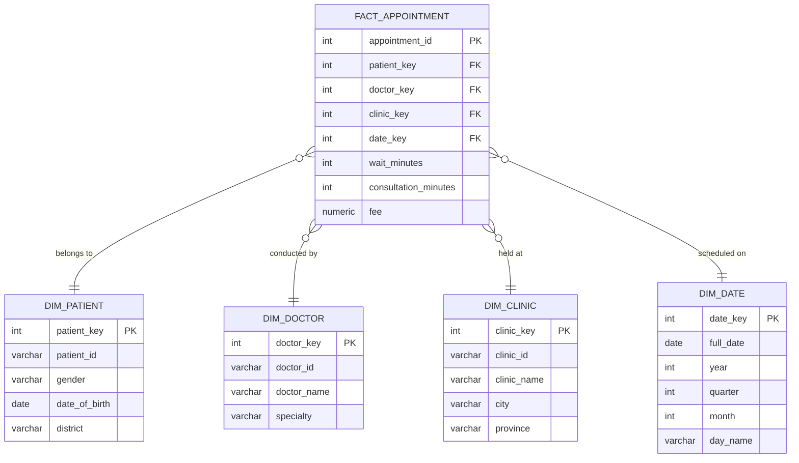

# 🏥 Healthcare Data Warehouse & Business Intelligence Platform

[](https://www.postgresql.org/)
[](https://www.python.org/)
[](https://pandas.pydata.org/)
[]()
[]()

An end-to-end Enterprise Healthcare Data Warehouse and Business Intelligence solution designed for multi-facility outpatient clinic networks. Ingests, cleans, and transforms raw transactional appointment logs into an optimized **Star Schema** data warehouse hosted on PostgreSQL, enabling high-performance analytical reporting and executive decision-making.

---

## 🏛️ Dimensional Data Architecture (Star Schema)

The analytical data warehouse is structured around the central business process of **Patient Appointments**, modeled at the discrete grain of a single patient encounter.



---

## 🔄 ETL & Data Engineering Pipeline

Raw hospital logs often contain data anomalies, inconsistencies, and formatting discrepancies. The custom ETL engine implemented in Python (`notebooks/healthcare_dw_etl_pipeline.ipynb`) applies rigorous data hygiene:

1. **Grain Integrity & Duplicate Elimination**: 
   - Evaluates composite business grain `[patient_id, doctor_id, clinic_id, appointment_date, appointment_time]` to detect and eliminate repeated booking collisions.
2. **Specialty Text Standardization**:
   - Cleans leading/trailing whitespaces and standardizes casing across medical specialty descriptions (e.g., standardizing cardiology, pediatrics, and internal medicine).
3. **Data Quality & Anomaly Handling**:
   - Identifies and corrects invalid negative waiting times (`wait_minutes < 0`) and resolves missing consultation fees through business rule imputation.
4. **Surrogate Key Generation**:
   - Replaces volatile operational business keys with integer surrogate keys across all dimension tables to insulate the warehouse from upstream source changes.
5. **Dimensional Conformance**:
   - Generates a complete 365-day calendar date dimension (`dim_date`) enriched with temporal hierarchies (Year, Quarter, Month, Day of Week).

---

## 🚀 Key Repository Structure

```text
├── data/                               # Raw operational CSV datasets
│   ├── appointments_raw.csv            # 1,500+ raw transactional appointment records
│   ├── clinics.csv                     # Healthcare facility profiles
│   ├── doctors.csv                     # Medical practitioner details
│   ├── patients.csv                    # Demographics & patient registry
│   └── patient_updates.csv             # Incremental patient updates
├── notebooks/
│   └── healthcare_dw_etl_pipeline.ipynb# End-to-end Python/Pandas ETL workflow
├── sql/
│   ├── 01_schema_ddl.sql               # PostgreSQL DDL with PK/FK constraints & indexes
│   └── 02_analytical_olap_queries.sql  # Production OLAP queries (ROLLUP, time-series)
├── .gitignore
└── README.md
```

---

## 📊 Analytical OLAP Queries & Business Insights

The loaded warehouse supports multi-dimensional decision analytics, implemented in `sql/02_analytical_olap_queries.sql`:

### 1. Hierarchical Workload & Revenue Breakdown (`ROLLUP`)
```sql
SELECT
    COALESCE(d.specialty, 'ALL SPECIALTIES') AS specialty,
    COALESCE(d.doctor_name, 'Subtotal / Total') AS doctor_name,
    COUNT(*) AS appointment_count,
    ROUND(AVG(f.fee), 2) AS avg_fee,
    SUM(f.fee) AS total_revenue
FROM fact_appointment f
JOIN dim_doctor d ON f.doctor_key = d.doctor_key
GROUP BY ROLLUP (d.specialty, d.doctor_name)
ORDER BY d.specialty NULLS LAST, d.doctor_name NULLS LAST;
```

### 2. Clinic Operational Efficiency (Wait vs. Consultation Time)
Evaluates patient throughput and clinic operational bottlenecks by cross-referencing average wait times against medical consultation durations.

---

## 🛠️ Tech Stack & Methodologies

* **Database Engine**: PostgreSQL 16+
* **Data Processing & ETL**: Python 3.x, Pandas, NumPy
* **Modeling Methodology**: Ralph Kimball Dimensional Modeling (Star Schema)
* **SQL Techniques**: Foreign Key Constraints, B-Tree Indexing, Multi-table Joins, Windowing & OLAP Aggregations (`ROLLUP`)
* **Environment**: Jupyter Notebook, psql CLI / pgAdmin

---

## 👩‍💻 Author
**Thilini Wasana**  
*Software Engineering Undergraduate — National Institute of Business Management (NIBM)*  
* **LinkedIn**: [thilini-wasana](https://www.linkedin.com/in/thilini-wasana-166117360)
* **GitHub**: [@Wasana1010](https://github.com/Wasana1010)
